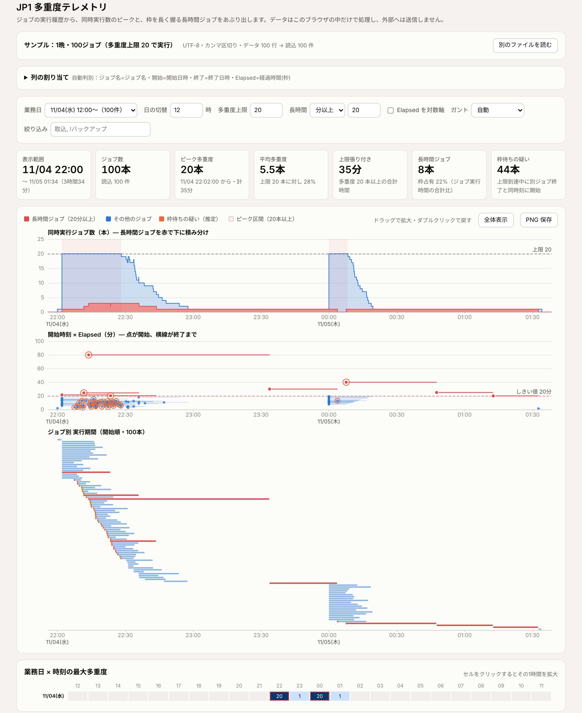
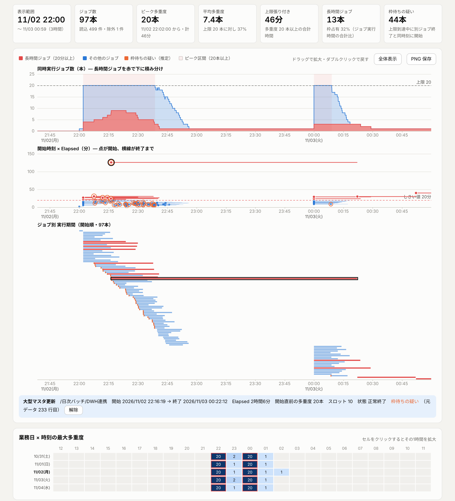

# JP1 多重度テレメトリ

JP1 ジョブネットの実行履歴（ジョブごとの開始日時・終了日時・Elapsed 秒）から、**同時に実行されていたジョブ数（多重度）の時系列**を描きます。時刻ごとのピークとボトルネック、そして枠を長く握る長時間ジョブを浮き彫りにするための道具です。

- **`jp1-telemetry.html`**：ブラウザで開いて CSV をドロップするだけ。インストール不要・外部通信なし（CSP で遮断）・閉域で使えます
- **`tools/jp1_concurrency.py`**：同じ計算を Python の標準ライブラリだけで行う CLI。JP1 の後続ジョブにして日次レポートを残す用途向けです



## 3 段のグラフで何が見えるか

横軸の時刻は 3 段で共有しています。カーソルの縦線 1 本で、同じ時刻の 3 段を同時に読めます。

| 段 | 縦軸 | 見るもの |
|---|---|---|
| 上段 | 同時実行ジョブ数（本） | 多重度の山。**長時間ジョブ（赤）を下に積み分け**ているので、山のうちどれだけを長いジョブが占めているかが分かります。点線は多重度上限、薄赤の帯はピーク区間です |
| 中段 | Elapsed（分） | 開始時刻×Elapsed の散布図。点が開始、横線が終了まで。赤い点線より上が長時間ジョブです。オレンジの輪は「枠待ちの疑い」 |
| 下段 | ジョブ（開始順）／スロット | ガント。「スロット詰め」にすると行数＝ピーク多重度になり、どの枠を誰が長く握っているかが見えます |

その下に、**業務日×時刻の最大多重度ヒートマップ**、**ピーク区間表**、**長時間ジョブ表**があります。セルや行をクリックすると、その時間帯へ拡大します。

### 見どころの例（同梱サンプル）

- **1 晩・100 ジョブ（多重度上限 20）**
  - 22:02〜22:28 と 00:00〜00:08 に上限へ張り付きます（計 35 分）
  - 23 時以降は、上段の赤い層が 1 本だけ続きます。全体の終了時刻を決めているのは、この長時間ジョブの列です
  - 大型マスタ更新（80 分）は 22:02 に起動可能でしたが、張り付き中だったため 22:13 まで開始できていません
- **5 晩・500 ジョブ**
  - ヒートマップで月曜（11/02）だけ 02 時台まで延びているのが分かります
  - その夜、大型マスタ更新は張り付き中に枠を待ってから開始し、さらに 2 時間 6 分かかっていました（下のスクリーンショット、ガントの黒枠）



## 使い方（利用者目線）

### A. グラフで見たい人（運用担当・性能分析）

1. `jp1-telemetry.html` をダブルクリックして、Edge か Chrome で開きます
2. 実行履歴の CSV／TSV を画面へドラッグ＆ドロップします（「ファイルを選ぶ」でも可）
   - まず試すときは「サンプル：1晩・100ジョブ」を押します
3. **多重度上限**に、実行ホスト／エージェントの同時実行数を入れます
   - 張り付き時間と「枠待ちの疑い」が出るようになります
4. 上段の山をドラッグして拡大します。ダブルクリックで元に戻ります
   - ジョブにカーソルを当てると詳細が出て、クリックで固定できます
5. 報告に使うときは「PNG 保存」「タイムライン CSV」「ジョブ別 CSV」「ピーク区間 CSV」で書き出します

複数日の履歴なら、**業務日**で 1 晩ずつ切り替えられます。**日の切替**（既定 12 時）で、日付をまたぐ夜間バッチを 1 晩としてまとめます。

### B. 毎晩レポートを残したい人（JP1 にジョブとして登録）

```bat
python tools\jp1_concurrency.py D:\jp1log\history.csv --limit 20 --day 2026-11-04 --out D:\jp1report\20261104 --png
```

出力ファイルは次のとおりです。

| ファイル | 内容 |
|---|---|
| `report.md` | 要約・ピーク区間・長時間ジョブ上位・業務日×時刻表 |
| `timeline.csv` | 多重度の階段 |
| `jobs.csv` | ジョブ別。長時間判定・開始直前の多重度・スロット・枠待ちの疑い |
| `peaks.csv` | ピーク区間 |
| `hourly.csv` | 業務日×時刻 |
| `concurrency.png` | 3 段グラフ。matplotlib がある場合だけ出力 |

Python 3.9 以上の標準ライブラリだけで動きます（PNG だけは matplotlib が必要）。

### C. 列がうまく読めないとき（どちらの方法でも）

- **画面**：「列の割り当て」を開き、ジョブ名・開始日時・終了日時（または Elapsed）を手で選び直します。プレビューで割り当て中の列が色付きになり、除外した行は理由と行番号が出ます
- **CLI**：`--map "start=開始日時,end=終了日時,name=ジョブ名"` で列名（または 1 始まりの列番号）を指定します
- **文字化け**：文字コードを Shift_JIS に切り替えます（CLI は `--encoding shift_jis`）

## 読める実行ログ

必要なのは、**ジョブ名・開始日時・「終了日時」または「Elapsed」**の 3 つだけです。出力手段（JP1/AJS3 - View の実行結果の保存、コマンド出力の保存、DB からの抽出など）は問いません。

| 項目 | 対応範囲 |
|---|---|
| 文字コード | UTF-8（BOM 有無）／Shift_JIS／UTF-16 を自動判別 |
| 区切り | カンマ・タブ・セミコロン・縦棒・空白揃え（2 文字以上の空白）を自動判別。クォート内のカンマも可 |
| ヘッダ | 日本語・英語の列名から自動判別（例：ジョブ名／ユニット名／JOB_NAME、開始日時／START_TIME、経過時間(秒)／ELAPSED）。ヘッダなしでも日時の列から推定。先頭のタイトル行は読み飛ばし |
| 日時 | `2026/11/04 22:00:00`、`2026-11-04T22:00:00`、`20261104220000`、`2026年11月4日 22時05分` など。日付と時刻が別列でも可。終了日の列がなく終了時刻だけの場合は、開始より前なら翌日とみなします |
| Elapsed | 秒（`864`）、`hh:mm:ss`、`mm:ss`、`1h 2m 3s`、`1時間2分` |
| 任意の列 | ジョブネット（絞り込みと表示）、状態（表示）、起動可能日時（**待ちを推定ではなく実測**で表示） |

終了日時も Elapsed も空の行（実行中など）は、件数と行番号を示して除外します。黙って捨てることはしません。

`tests/fixtures/` に、Shift_JIS＋タブ＋日付と時刻が別列、ヘッダなし＋クォート、Elapsed のみ＋タイトル行、空白揃え、の例があります。

## 指標の定義

| 指標 | 定義 |
|---|---|
| 同時実行ジョブ数（多重度） | 各ジョブを [開始, 終了) の半開区間として、開始で +1・終了で −1 した累積です。同じ秒の終了と開始は重ねません |
| 長時間ジョブ | Elapsed がしきい値以上のジョブ。しきい値は「N 分以上」と「上位 N%」（選択中の業務日の分位点）から選べます |
| 上限張り付き | 多重度が上限以上だった時間の合計 |
| 枠待ちの疑い（推定） | 開始の直前まで多重度が上限に達していて、かつ別ジョブの終了と同じ秒に開始したジョブ |
| ピーク区間 | 多重度が判定ライン以上の連続区間（60 秒未満の切れ目は連結）。判定ラインは多重度上限、未入力なら選択範囲のピークの 80% |
| 枠占有 | 長時間ジョブの実行時間合計 ÷ 全ジョブの実行時間合計（表示範囲内） |
| 業務日 | 開始日時から「日の切替」時刻を引いた日付 |

### 「枠待ちの疑い」の当たり具合（実測）

正解の分かるシミュレーションで測りました（`tests/test_ground_truth.py`）。

| サンプル | 実際に待った | 推定 | 適合率 | 再現率 |
|---|---:|---:|---:|---:|
| 1 晩・100 ジョブ | 44 本 | 44 本 | 100% | 100% |
| 5 晩・499 ジョブ | 222 本 | 226 本 | 98% | 100% |

外れた 4 本は、張り付き中に先行ジョブが終わり、その瞬間に起動可能になってそのまま空き枠に入ったジョブです（実際には待っていない）。実行ログに起動可能日時がない限り、この 2 つは区別できません。起動可能日時の列があれば、推定ではなく実測を表示します。

## 2 つの方法の違い

| 機能 | ブラウザ版（本命） | CLI 版（代替） |
|---|---|---|
| 必要なもの | Edge／Chrome だけ | Python 3.9+（PNG は matplotlib も） |
| 多重度・ピーク区間・長時間・張り付き・枠待ちの疑い・スロット・ヒートマップ | ✅ | ✅ 同じ計算（突合テストで一致を確認） |
| 列の自動判別・Shift_JIS・空白揃え | ✅ | ✅ |
| 拡大・ホバー・クリックでの深掘り | ✅ | ❌ 静止画と表のみ |
| しきい値・上限を見ながら変える | ✅ その場で再計算 | ❌ 引数を変えて再実行 |
| 定期実行・無人運転（JP1 の後続ジョブ） | ❌ | ✅ |
| 結果を文書に残す | PNG・CSV を手で保存 | report.md と CSV を自動で保存 |

## 規模と速度（実測）

52,700 行・3.7 MB（31 晩 × 1,700 ジョブ）で計測しました。

| 処理 | 時間 |
|---|---|
| ブラウザ：読込から描画まで | 1.3 秒 |
| ブラウザ：ホバー | 1 回あたり約 20 ms |
| ブラウザ：業務日の切替 | 0.2 秒 |
| CLI：全期間 | 2.0 秒 |
| CLI：1 晩＋PNG | 3.7 秒 |

## 注意

- 日時はログに書かれたローカル時刻のまま扱います（タイムゾーン・夏時間の変換はしません）
- 多重度上限は実行ログから分からないため、入力が必要です。実行先ホストやエージェントごとに上限が違う場合は、絞り込みでホスト（ジョブネット）単位に分けて見てください
- 計測したのは 3.7 MB までです。それより大きなログで重い場合は、CLI の `--day` で 1 晩に絞るか、ログを業務日単位に分けて開いてください

## ファイル構成

```
jp1-telemetry.html          ブラウザ版（単一ファイル。サンプル 2 種を埋め込み済み）
tools/jp1_concurrency.py    CLI 版（標準ライブラリのみ）
tools/make_sample.py        サンプル生成（100 ジョブを多重度上限つきでシミュレーション）
tools/embed_samples.py      samples/ を HTML に埋め込む（--check で一致検査）
samples/                    1 晩・100 ジョブ／5 晩・500 ジョブ
tests/                      単体テスト・JS⇔Python 突合・推定の当たり具合
docs/operations.md          運用の役割×時間軸（初回〜撤退）
docs/requirements-checklist.md  会話で確定した要件と突合結果
```

## 開発・検証

```sh
node tests/test_core.js             # CORE 単体テスト（13 件）
python tests/test_crosscheck.py     # JS と Python の結果突合（6 入力 × 設定 = 25 通り）
python tests/test_ground_truth.py   # 枠待ちの疑いの適合率・再現率
python tools/embed_samples.py --check
```

GitHub Actions（`.github/workflows/test.yml`）でも同じものを実行します。

ブラウザ版の計算部分は `jp1-telemetry.html` の `// ==CORE-BEGIN==` から `// ==CORE-END==` の間にあり、テストはそこだけを取り出して Node で実行します。計算を直すときは、HTML と `tools/jp1_concurrency.py` の両方を直してから突合テストを通してください。
