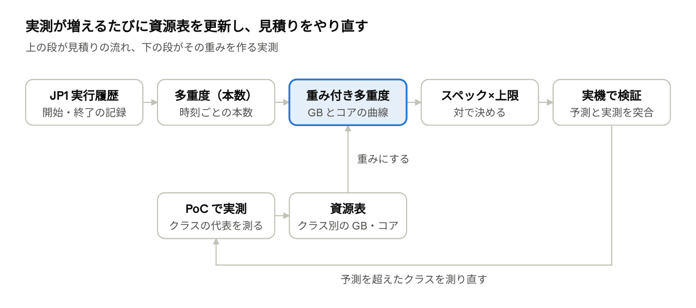
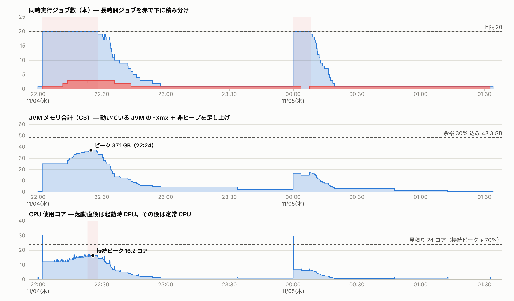
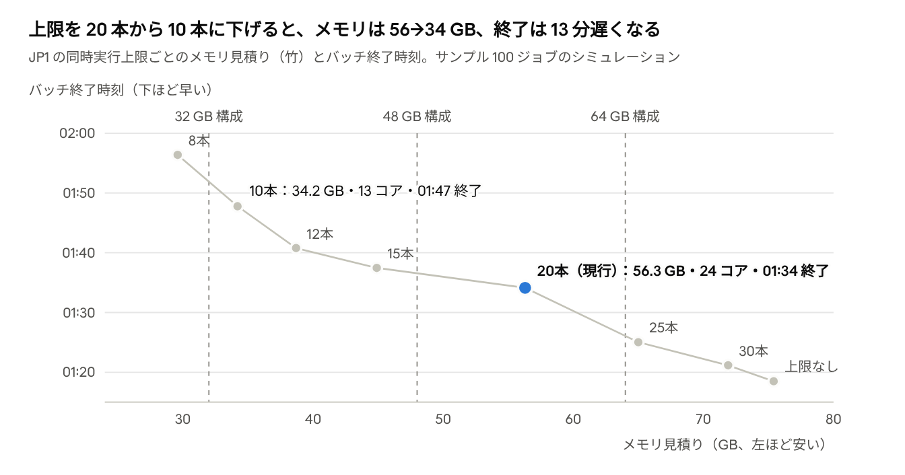

# Java バッチ用 Windows サーバの容量見積り手順

作成日：2026-11-05（Claude のドキュメントから書き出し。図は同じものを画像で収録）

## 要点

サーバのスペックは、多重度グラフの縦軸「本数」を、ジョブごとの資源量で重み付けして「GB」と「コア」に描き直し、そのピークで決める。

- **メモリ**：時刻ごとに「その瞬間に動いている JVM のメモリ」を足し上げた曲線の最大値に、OS・常駐分と余裕を加える。「本数ピーク×1本あたり最大メモリ」は上限見積り（過大になりやすい）として並べて示す
- **1 JVM のメモリ**：-Xmx（ヒープ上限）＋非ヒープ（Metaspace・コードキャッシュ・スレッド・GC 管理領域）を、Windows のコミット量（Private Bytes）で数える。使用ヒープではなく、確保されうる量で数える
- **CPU**：定常の使用コア（CPU 時間÷Elapsed）と、起動直後の JIT・クラスロードの山を分けて重ねる。22:02 や 00:00 のような同時起動が CPU のピークを作る
- **JVM 設定が前提**：-Xmx を必ず明示し、GC・JIT のスレッド数を絞る。既定のままだと、ヒープ上限が物理メモリの 1/4、GC スレッドがコア数に比例して決まり、20 本並ぶと見積りが崩れる
- **スペックと JP1 の同時実行上限は対で決める**：上限 N 本なら、メモリは「大きい順に N 本分の合計」を超えない。これが保証値になる

## 確定事項と前提

会話で決まったことは 6 点。この一覧で、最後に手順書の抜け漏れを突合する。

| No | 確定事項 | 反映箇所 |
| --- | --- | --- |
| 1 | 目的は、現行 COBOL バッチを Java に完全移行し、Java バッチ用 Windows サーバのスペックを決めること | 全体 |
| 2 | 1 ジョブ＝1 プロセス（1 JVM）で起動する | 1 JVM の中身、計算式 |
| 3 | 1 ジョブのメモリは「JVM の初動確保メモリ＋使用ヒープ」を加算して考える | 1 JVM の中身（数え方を具体化） |
| 4 | 多重度のピークから、最大 CPU コアと最大メモリ容量を予測する | 当てはめ方、手順 |
| 5 | 入力は JP1 実行履歴（ジョブごとの開始・終了・Elapsed） | 手順 Step 1 |
| 6 | 分析には JP1 多重度テレメトリ（ブラウザ版・CLI 版、外部通信なし）を使う | 手順、試算例 |

突合結果：6 項目とも、反映箇所の列に示した節に書いた。未反映はない。

**確定事項 3 の数え方を 1 点だけ具体化する。** ヒープは「使用量」ではなく「-Xmx（確保されうる上限）」で数える。Windows は確保（コミット）した分を物理メモリかページングファイルで裏付けるため、使用量が小さくても確保分は席を取るからだ。使用ヒープの実測値は、-Xmx を決める根拠（実測ピーク×1.3〜1.5）に使う。

**前提**

- JP1 の起動条件（先行関係・時刻起動）は移行後も変えない。したがって「いつ何本並ぶか」は現行の実行履歴から読める
- Java 化で Elapsed が変わると重なり方が変わる。これは Elapsed 倍率のシナリオで補正する（手順 Step 5）
- 同じサーバに同居するもの（OS、JP1/AJS3 のエージェント、監視・ウイルス対策、DB クライアント）は「OS・常駐分」としてまとめて足す

**未確定（測るまでは仮置きで進め、実測で置き換える）**

- Java 版のジョブごとのヒープ必要量・非ヒープ量・CPU 時間・Elapsed（PoC で測る）
- バッチウィンドウの終了期限、サーバ台数（1 台集約か複数台か）、冗長化の要否
- 実際の JP1 実行ログ（年次・月末のピーク日を含む期間）

## 全体像と方針の判断

見積りは「竹：クラス別の重み付き多重度」で始め、移行が進むにつれて実測値で「松」に置き換える。「梅」は予算の上限として常に並べて示す。

どの案も、入力は同じ実行履歴である。違うのは「1 本あたり何 GB・何コアと数えるか」の細かさだけである。

| 案 | やり方 | 必要なデータ | 結果の性質 | 判断 |
| --- | --- | --- | --- | --- |
| 梅：本数×一律 | ピーク多重度 × 1 本あたり最大メモリ（最大 -Xmx＋非ヒープ） | 実行履歴と、最大ジョブ 1 本の設定値 | 過大（安全側）。重いジョブ 1 本の値が全本数に掛かる | 予算の上限として併記 |
| 竹：クラス別の重み付き多重度 | ジョブを S・M・L などに分け、クラスの代表値で時刻ごとに足し上げてピークを取る | 実行履歴と、クラスごとに PoC で測った 3〜5 本 | 実態に近い。クラス分けの誤りがリスク | **採用**（移行初期から使える） |
| 松：ジョブ別実測＋シナリオ | 移行済みジョブを個別に実測し、Elapsed 倍率・データ増・再実行のシナリオで再計算する | GC ログ、Private Bytes、CPU 時間の実測 | 最も正確 | 移行の進捗に合わせて竹を置き換える |

数百〜千本規模の移行では、全ジョブを先に実測することはできない。だから竹で始める。竹と松は同じ計算で、代表値が実測値に入れ替わっていくだけなので、作り直しは起きない。

重み付き多重度の計算は、JP1 多重度テレメトリに「容量見積り」として追加する（ブラウザ版・CLI 版の両方）。ツールが使えない場合も、Excel の SUMIFS で同じ値を出せる（計算式の節）。



見積りの中心は「重み付き多重度」で、実行履歴の本数に資源表の GB・コアを掛けて作る。検証で外れたクラスは実測に戻る。

## 1 ジョブ＝1 JVM のメモリと CPU の中身

1 本の JVM のメモリは「-Xmx（ヒープ上限）＋非ヒープ」で数える。非ヒープは起動直後のクラス読込でほぼ決まり、これが「JVM の初動確保メモリ」に当たる。ヒープが小さいジョブほど、非ヒープの割合が大きい。

| 区分 | 中身 | 上限を決める設定 | 測り方 |
| --- | --- | --- | --- |
| ヒープ | 業務データのオブジェクト | -Xmx（初期値は -Xms） | GC ログ（`-Xlog:gc*`）の使用量ピーク |
| Metaspace | クラスのメタデータ。Spring などのフレームワークで増える | -XX:MaxMetaspaceSize | NMT（-XX:NativeMemoryTracking=summary と jcmd VM.native_memory） |
| コードキャッシュ | JIT が生成した機械語 | -XX:ReservedCodeCacheSize | NMT |
| スレッドスタック | GC・JIT・アプリのスレッド数 × -Xss | スレッド数、-Xss | NMT |
| GC 管理領域・その他 | GC のデータ構造、シンボル、内部領域 | GC の種類とヒープサイズ | NMT |
| ダイレクトバッファ | NIO のファイル・通信 I/O | -XX:MaxDirectMemorySize | NMT |
| Windows から見た合計 | 上のうち確保（コミット）された分 | — | パフォーマンスモニターの `Process(java)\Private Bytes` |

1 本あたりの見積りは「-Xmx＋非ヒープ実測値」とする。-Xms を -Xmx と同じにすると、実際の確保量が見積りどおりになり、検証もしやすい。

**CPU は 2 つに分けて数える。**

- 定常：CPU 時間 ÷ Elapsed。例えば Elapsed 10 分で CPU 時間 6 分なら 0.6 コア。DB・ファイルの I/O 待ちが多いバッチほど小さい
- 起動直後：クラス読込と JIT コンパイルで、数秒から数十秒、定常より多くのコアを使う。同じ時刻に 20 本起動すると、その間だけ CPU が跳ねる

**既定のままだと見積りが崩れる落とし穴が 3 つある。**

1. -Xmx を指定しないと、ヒープ上限は物理メモリの 1/4 になる。128 GB のサーバなら 1 本あたり最大 32 GB まで確保しうる。全ジョブで -Xmx を明示する
2. GC スレッド数はサーバのコア数で決まる（8 コアまではコア数、それ以上は 8＋（コア数−8）×5/8）。32 コアでは 1 本 23 スレッド、20 本並ぶと 460 スレッドが CPU を奪い合う。-XX:ActiveProcessorCount（または -XX:ParallelGCThreads など）で絞る
3. GC の種類もコア数とメモリ量で自動選択される。小さいヒープの短いバッチでは Serial GC や Parallel GC の方が軽いことがあるため、PoC で比べて明示する

Windows は、確保の合計がコミット上限（物理メモリ＋ページングファイル）を超えると、新しい JVM の起動やヒープ拡張に失敗する。ページングに頼った分は遅くなるため、ピーク時の確保合計は物理メモリの中に収める。

## 多重度グラフへの当てはめ方

上段の「本数」を、ジョブごとの GB・コアで重み付けして足し直すのが当てはめの中心である。残りの部分は、どの日を対象にするか、どのジョブを重いクラスにするか、上限をどう掛けるかを決めるのに使う。

| グラフの部分 | 読み取るもの | 見積りでの使い道 |
| --- | --- | --- |
| 上段：同時実行ジョブ数 | 本数の山とその時刻 | 縦軸を GB・コアに描き直す土台。本数のピーク×1 本あたり最大メモリ＝梅（上限見積り） |
| ピーク区間表 | ピークのとき並んでいるジョブ | その瞬間のジョブごとのメモリを足すと、その時刻の必要量になる |
| 中段：開始時刻×Elapsed | 長時間ジョブ、同じ時刻に縦に並ぶ点 | 縦に並んだ点の数＝同時起動の本数で、起動 CPU の山の高さを決める。長時間ジョブは重いクラスの候補 |
| 下段：スロット詰め | 行数＝必要な席数、席ごとの占有 | JP1 の同時実行上限＝席数。上限 N 本のときの保証値を出す |
| 業務日×時刻のヒートマップ | どの日のどの時間が濃いか | 見積りの対象日（月曜・月末・期末など最も重い日）を選ぶ |
| 上限張り付きと枠待ちの疑い | 現行の上限で待たされているジョブ | 実際の需要が上限を超えている印。Java 側の上限を上げるか据え置くかの判断材料 |

**注意する点が 2 つある。**

- **メモリのピークは、本数のピークと別の時刻に来ることがある。** 軽いジョブ 20 本より、重いジョブ 3 本の時間帯の方が大きい場合がある。そのため、ピーク区間だけでなく全時刻で足し上げ、曲線の最大値を取る
- **観測されたピークは、現行の同時実行上限を超えない。** 張り付いている区間では、本当の需要はもっと大きい。上限を据え置くなら、観測値で見積もってよい（終了時刻も現行並み）。上限を上げて待ちを消すなら、待ちの分だけ本数が増える前提で見積もる（制約と代替案の節）

## 手順

9 つの手順で進める。Step 4 の実測が増えるたびに、Step 5・6 をやり直して見積りを更新する。

0. **目的と制約を決める**（アーキテクト）
    - バッチウィンドウの終了期限、対象にする業務日の種類（通常日・月曜・月末・期末・年度末）、サーバ台数の方針、JDK の版を決める
    - 出力：前提シート
1. **実行履歴を集める**（JP1 運用）
    - 直近 1〜3 か月分に加え、前年の月末・期末・年度末を含める。ジョブ名・ジョブネット・開始・終了（または Elapsed）を CSV にする
    - 現行の同時実行上限の設定値も控える
    - 出力：実行履歴 CSV、現行の上限
2. **多重度を描いて対象日を選ぶ**（アーキテクト）
    - ツールに CSV を読み込み、多重度上限を入れる。ヒートマップで最も濃い業務日を 3〜5 日選ぶ
    - 張り付き時間と枠待ちの疑いを控える（現行の上限がすでに詰まっているか）
    - 出力：対象日の一覧、現行の飽和状況
3. **ジョブをクラスに分ける**（アーキテクトと開発）
    - 処理するデータ量、処理の種類（取込・集計・帳票・DB 更新）、中段の Elapsed で S・M・L などに分ける。長いことと重いことは別なので、データ量で判断する
    - クラスごとに代表ジョブを 3〜5 本選ぶ
    - 出力：資源表のパターンとクラスの列（付録の書式）
4. **代表ジョブを PoC で測る**（PoC 開発）
    - Java 版を本番相当のデータ量と、本番と同じ JVM オプション（付録）で動かす
    - GC ログの使用量ピーク×1.3〜1.5 を -Xmx にする。NMT で非ヒープを測り、Private Bytes で合計を検算する
    - CPU 時間÷Elapsed で定常 CPU、起動から業務処理開始までの時間と CPU で起動時 CPU を出す。Elapsed の Java/COBOL 比も取る
    - 出力：資源表の値（ヒープ・非ヒープ・定常 CPU・起動 CPU・起動秒）、Elapsed 倍率
5. **容量を計算する**（アーキテクト）
    - ツールの「Java 移行の容量見積り」に資源表を貼り、既定値（資源表にないジョブの値）と Elapsed 倍率を入れる
    - 対象日を 1 日ずつ切り替え、メモリ見積り・CPU 見積り・梅・保証値を記録する。日次で残すなら CLI の --profile を使う
    - データ増は、資源表のヒープを増加率分だけ大きくして、もう一度計算する
    - 出力：対象日ごとの見積り値（最大値を採用）
6. **スペックと同時実行上限を対で決める**（アーキテクトとインフラ）
    - メモリとコアは、対象日の最大値を構成の刻みに切り上げる。Windows Server は物理コアをすべてライセンスし、サーバ当たり最低 16 コア分が必要なので、16 コア未満の見積りでも 16 コア分の費用は掛かる（[Microsoft](https://www.microsoft.com/licensing/guidance/Windows-Server-2025)）
    - JP1 の同時実行上限 N は、保証値（大きい順 N 本の合計）が搭載メモリを超えない範囲で選ぶ。終了期限との兼ね合いは制約と代替案の節で決める
    - ページングファイルは、コミット上限の余力として置く（常用はしない）
    - 出力：スペック案（メモリ GB・コア数）と JP1 の上限値
7. **JVM 設定を標準化する**（開発）
    - クラスごとに -Xmx・-Xms、GC、スレッド数、Metaspace 上限を固定し、起動スクリプトに埋め込む（付録の雛形）
    - 出力：クラス別の JVM オプション
8. **実機で検証する**（インフラと JP1 運用）
    - 対象日の 1 夜を実機で再現し、予測と実測を突合する（実機での検証の節）。外れたクラスは Step 4 に戻って測り直す
    - 出力：検証結果と、更新した資源表

## 計算式と試算例

サンプル 100 ジョブ（上限 20）では、竹の見積りはメモリ 56.3 GB・CPU 24 コア、梅は 121.8 GB だった。梅は重いジョブ 1 本（4.4 GB）の値を 20 本全部に掛けるため、竹の 2 倍以上になる。

**計算式**（e′ は Elapsed 倍率 α を掛けた終了時刻、開始は据え置き）

```math
M_j = \mathrm{Xmx}_j + \mathrm{NonHeap}_j, \qquad e'_j = s_j + \alpha\,(e_j - s_j)
```

```math
\mathrm{Mem}(t) = \sum_{j:\; s_j \le t < e'_j} M_j, \qquad \text{メモリ見積り} = \text{OS・常駐} + \max_t \mathrm{Mem}(t) \times (1 + \text{余裕})
```

```math
\mathrm{Cpu}(t) = \sum_j c_j(t), \quad c_j(t) = \begin{cases} \text{起動時 CPU} & s_j \le t < s_j + \text{起動秒} \\ \text{定常 CPU} & s_j + \text{起動秒} \le t < e'_j \end{cases}
```

```math
\text{CPU 見積り} = \left\lceil \max_x \frac{1}{W}\int_x^{x+W} \mathrm{Cpu}(t)\,dt \;\div\; \text{目標使用率} \right\rceil
```

```math
\text{上限 } N \text{ 本の保証値} = \text{OS・常駐} + \Big(\text{大きい順に } N \text{ 本の } M_j \text{ の合計}\Big) \times (1 + \text{余裕})
```

W は CPU を平均する幅（既定 5 分）。同時起動の瞬間的な山でコアを決めないためのもので、瞬間の山は「起動が遅れる」だけで止まらない。

**試算例**：サンプル 1 晩・100 ジョブ。既定値は -Xmx 512 MB・非ヒープ 256 MB・定常 0.5 コア・起動時 1.5 コア×15 秒、OS・常駐 8 GB、余裕 30%、目標使用率 70%。資源表は [samples/profile_sample.csv](../samples/profile_sample.csv)（L：最大 4 GB、M：1〜1.5 GB、S：256〜512 MB の仮置き値）。

| 項目 | 既定値だけ（全ジョブ同じ） | 資源表あり（竹） |
| --- | --- | --- |
| JVM メモリのピーク | 15.0 GB（22:02） | 37.1 GB（22:24） |
| **メモリ見積り** | **27.5 GB**（32 GB 構成） | **56.3 GB**（64 GB 構成） |
| 梅：本数ピーク×最大 JVM | 27.5 GB | 121.8 GB |
| 上限 20 本の保証値 | 27.5 GB | 59.7 GB |
| CPU の持続ピーク（5 分平均） | 11.0 コア | 16.2 コア（22:23 から） |
| **CPU 見積り** | **16 コア** | **24 コア** |
| CPU の瞬間最大 | 30.0 コア（22:02） | 30.0 コア（22:02） |

同じ時刻軸で並べると、上段の「本数」が中段の「GB」と下段の「コア」に換算される様子が分かる（ツールの画面、資源表あり）。



読み取れることは 3 つある。

- メモリのピークは、本数が初めて 20 本に達した 22:02 ではなく 22:24 に来た。取込（M、1.3 GB）が終わった枠に、より重い集計（M、1.8 GB）が入ったためである
- CPU の瞬間最大 30 コアは、22:02 に 20 本が同時起動した 15 秒間だけ。持続ピークは 16.2 コアである
- 上限 20 本の保証値（59.7 GB）は見積り（56.3 GB）とほぼ同じ。「上限を守れば 64 GB を超えない」と言い切れる

**ツールが使えないときは Excel で出せる。** 階段状のメモリ曲線は、どこかのジョブの開始時刻で最大になる。そこで各行に「その開始時刻に動いている JVM の合計」を出し、その最大を取る。

```text
各行の Mem = SUMIFS(M列, 開始列, "<="&開始, 終了列, ">"&開始)
JVM メモリのピーク = MAX(Mem 列)
```

## 制約が出たときの代替案

スペックに上限があるなら、JP1 の同時実行上限を下げてメモリを抑え、その分終了が遅れることを受け入れる。サンプルでは上限を 20 本から 10 本にすると、メモリ見積りは 56.3 GB から 34.2 GB に下がり、終了は 01:34 から 01:47 に延びた。



samples/ の 100 ジョブを先行関係どおりに上限別でシミュレーションし、jp1_concurrency.py の容量見積りで算出した。

上限を下げても全ジョブは流れ、メモリは保証値を超えない。遅れの大きさはジョブネットの先行関係で決まり、実行履歴だけでは計算できない。実データでは、JP1 の検証環境で上限を変えて 1 夜ずつ流して測る。

よく出る制約と代替案を、何が同じで何ができなくなるかで並べる。

| 制約の一言 | 代替案 | 同じく提供できること | できなくなること |
| --- | --- | --- | --- |
| 「そのメモリは載せられない」 | JP1 の同時実行上限 N を下げ、保証値を搭載量以下にする | 全ジョブの実行、メモリが溢れないこと | 終了時刻（上のグラフの分だけ遅れる） |
| 「コアを減らしたい（ライセンス費）」 | 同時起動をずらす、起動を速くする（クラスデータ共有など）。コアは持続ピークで決める | I/O 中心のバッチなら同じ終了時刻 | 起動が重なる時刻の立ち上がりの速さ |
| 「重いジョブ 1 本のために全体が大きくなる」 | 重いクラスだけ、同時実行数を別に絞れる実行先に分ける（上限 1〜2 本） | ほかのジョブの多重度 | 重いジョブどうしの並列（直列になる） |
| 「1 台に載らない」「冗長化が要る」 | 2 台に分け、ジョブネット単位で振り分ける。台ごとに重み付き多重度を出し直す | 合計の処理能力 | 片側障害時に 1 台で全量を回すこと（回すなら 1 台で全量の見積りが要る） |
| 「Java の方が遅かった」 | Elapsed 倍率を入れて再計算する。上限を守るならメモリは保証値で頭打ち | メモリの上限 | 終了時刻（重なりが増えた分は JP1 が待たせる） |

## 利用者目線：誰が結局何をするか

見積りに関わるのは 5 つの役割で、それぞれ受け取るものと渡すものが決まっている。

| 役割 | 受け取るもの | やること | 渡すもの |
| --- | --- | --- | --- |
| アーキテクト（見積り責任者） | 実行履歴 CSV、資源表 | 対象日を選び、クラスを分け、ツールで見積る。上限 N を決める | スペック案、上限 N、松竹梅と保証値 |
| PoC 開発 | 代表ジョブの一覧、JVM オプション雛形 | 本番相当データで動かし、GC ログ・NMT・CPU 時間を測る | 資源表の値、Elapsed 倍率 |
| JP1 運用 | 対象期間、決まった上限 N | 実行履歴を CSV で出す。現行の上限を伝える。検証の夜を流す | 実行履歴 CSV、現行の上限、検証夜の履歴 |
| インフラ | スペック案 | 構成を手配し、ページングファイルと計測（typeperf）を設定する | 検証夜の計測 CSV |
| 承認者（PM・発注者） | 松竹梅、上限と終了時刻のトレードオフ図 | 予算と終了時刻のどちらを優先するか決める | 採用する構成と上限 |

**アーキテクトの画面操作は 6 ステップ。**

1. jp1-telemetry.html を Edge か Chrome で開き、実行履歴 CSV をドロップする
2. 多重度上限に現行の設定値を入れ、業務日を対象日に切り替える
3. 「Java 移行の容量見積り」の「ジョブ別・クラス別の値」に資源表を貼る（一致しない行は画面が教える）
4. 既定値（資源表にないジョブの値）と Elapsed 倍率、OS・常駐、余裕を入れる
5. メモリ見積りと CPU 見積り（青枠の 2 つ）を読む。ピーク時刻に動いている JVM の表で、大きいものから内訳を確かめる
6. 多重度上限を変えて保証値を見る。決めた値は「容量タイムライン CSV」と PNG で残す

## 運用：役割×時間軸の格子

見積りは一度出して終わりではなく、移行が進むたびに実測で置き換えていく。そのため、初回から撤退までの各局面で誰が何をするかを先に決めておく。

| 時間軸 | アーキテクト | PoC 開発 | JP1 運用 | インフラ |
| --- | --- | --- | --- | --- |
| 初回 | 前提シートを作り、既定値（仮置き）で梅と竹を出す | クラスごとの代表 3〜5 本を測る | ピーク日を含む実行履歴と現行の上限を渡す | 梅を予算上限として構成候補を洗い出す |
| 2 回目以降（移行の節目ごと） | 資源表を更新して竹を出し直す。変化を記録する | 移行済みジョブの実測で代表値を置き換える | 直近の実行履歴を足す | 構成の確定時期を共有する |
| 差し戻し（実測が見積りを超えた） | 超えたクラスと時刻を特定し、上限 N か構成を見直す | 外れたクラスを測り直す。-Xmx の根拠を確かめる | 暫定で上限を下げる | ページングと空きメモリの実測を渡す |
| 途中中断 | どの資源表・どの既定値で出したかを CSV と PNG で残しておき、再開時に同じ結果を出せるようにする | 測定条件（データ量・JVM オプション）を資源表の注記に書く | — | — |
| ツール更新 | 更新前後で同じ入力の結果を比べる | — | — | — |
| 棚卸し（四半期ごと） | 月末・期末の実績で見積りと実測の差を確かめる | 使われなくなったクラスやルールを整理する | 上限の設定値と張り付き時間を報告する | コミット量・CPU の月次ピークを報告する |
| 肥大（ジョブ追加・データ増） | 追加分を資源表に入れて再計算し、余裕を使い切る時期を予測する | 新しいジョブを測り、クラスを割り当てる | 新しいジョブネットの起動時刻を伝える | 拡張の前倒しが要るか判断する |
| 引き継ぎ | 本書、資源表、前提シート、直近の見積り結果を渡す | 計測手順と JVM オプションの根拠を渡す | 実行履歴の出し方を渡す | 計測の設定（カウンタ一覧）を渡す |
| 撤退（COBOL 並行稼働の終了） | 実行履歴の入力を Java 版の実行履歴に切り替え、実測ベースの容量管理へ移る | 資源表を実測の最終値で確定する | COBOL 側の実行履歴の保管期限を決める | 余った構成の返却・縮退を判断する |

## 実機での検証

対象日の 1 夜を、本番相当のデータ量・本番と同じ同時実行上限で流し、ツールの予測曲線と Windows の実測を同じ時刻軸で重ねる。予測を信じず、測って突合するのがこの手順の終点である。

**測るもの**（5 秒間隔、typeperf で CSV に残す）

| カウンタ | 見るもの | ツールの予測との対応 |
| --- | --- | --- |
| `\Memory\Committed Bytes` | 確保の合計 | OS・常駐＋JVM メモリ合計 |
| `\Memory\Commit Limit` | 確保できる上限（物理＋ページングファイル） | — |
| `\Memory\Available MBytes` | 空き物理メモリ | — |
| `\Memory\Pages/sec` | ページングの量 | ピーク時に増えていないこと |
| `\Process(java*)\Private Bytes` | JVM ごとの確保量 | 資源表の -Xmx＋非ヒープ |
| `\Processor(_Total)\% Processor Time` | CPU 使用率 | CPU 使用コア ÷ コア数 |
| `\System\Processor Queue Length` | CPU 待ちのスレッド数 | — |

```text
typeperf -cf counters.txt -si 5 -f CSV -o peak_night.csv
```

counters.txt には上の表のカウンタを 1 行ずつ書く。JVM 側では GC ログを全ジョブで残し、ヒープの使用量ピークが -Xmx の余裕内にあるかも見る。

**合否の基準（具体的な値は Step 0 で決める）**

- Committed Bytes のピークが物理メモリに収まり、ピーク時に Pages/sec が増えていない
- JVM 分の実測ピークが、ツールの「JVM メモリのピーク」に余裕率を掛けた値を超えない
- % Processor Time の 5 分平均が目標使用率以下。Processor Queue Length がコア数の 2 倍を超えて続かない（一般的な目安）
- バッチの終了が終了期限より前

外れたら、ツールの「容量タイムライン CSV」と typeperf の CSV を時刻で並べ、どの時刻にどのクラスが予測を超えたかを特定する。そのクラスを Step 4 に戻して測り直す。

## 付録

### A. JVM オプションの雛形（クラス M の例）

```text
java -Xms1536m -Xmx1536m ^
  -XX:ActiveProcessorCount=2 ^
  -XX:+UseParallelGC ^
  -XX:MaxMetaspaceSize=256m ^
  -Xlog:gc*:file=logs\gc_%p.log:time,uptime:filecount=5,filesize=10m ^
  -XX:+HeapDumpOnOutOfMemoryError -XX:HeapDumpPath=logs ^
  -jar batch.jar （ジョブの引数）
```

| オプション | 理由 |
| --- | --- |
| -Xms と -Xmx を同じにする | 確保量を見積りどおりに固定し、検証をしやすくする |
| -XX:ActiveProcessorCount=2 | GC・JIT のスレッド数をサーバのコア数から切り離す |
| -XX:+UseParallelGC | 例。Serial・Parallel・G1 を PoC で比べて決める |
| -XX:MaxMetaspaceSize | 非ヒープの暴走を止める。PoC の実測に余裕を足した値にする |
| `-Xlog:gc*` | ヒープ使用量のピークを本番でも追えるようにする |
| -XX:+HeapDumpOnOutOfMemoryError | -Xmx が足りなかったときの原因を調べられるようにする |

### B. PoC での計測コマンド

```text
java -XX:NativeMemoryTracking=summary …   （PoC のときだけ。多少の負荷が掛かる）
jcmd <pid> VM.native_memory summary       （非ヒープの内訳）
jcmd <pid> GC.heap_info                   （ヒープの確保と使用）
```

### C. 資源表の書式

1 行 1 ルールで、上から順に最初に一致した行を使う。空欄は既定値で埋まる。パターンには `*` と `?` が使え、`/` を含むと「ジョブネット/ジョブ名」と照合する。値は説明用の仮置きである。

```csv
パターン,クラス,ヒープMB,非ヒープMB,定常CPU,起動CPU,起動秒
大型マスタ更新,L,4096,384,1.0,2.0,20
DWH連携,L,3072,320,0.6,,
集計*,M,1536,,0.8,,
受信取込*,M,1024,,0.6,,
帳票出力*,S,512,,0.4,,
```

### D. ツール

- ブラウザ版は [jp1-telemetry.html](../jp1-telemetry.html)、CLI 版は [tools/jp1_concurrency.py](../tools/jp1_concurrency.py)（Python 標準ライブラリのみ）
- CLI での日次見積り：`python tools\jp1_concurrency.py 実行履歴.csv --limit 20 --day 2026-11-04 --profile 資源表.csv --png`
- 出力：report.md の「Java 移行の容量見積り」節、capacity.csv、capacity.png
- ブラウザ版と CLI 版は同じ計算で、突合テスト（38 通り）で一致を確かめている

### 出典

- [Windows Server 2025 licensing guidance](https://www.microsoft.com/licensing/guidance/Windows-Server-2025)（Microsoft）— 物理コアの全数ライセンス、プロセッサ当たり最低 8・サーバ当たり最低 16 コア
